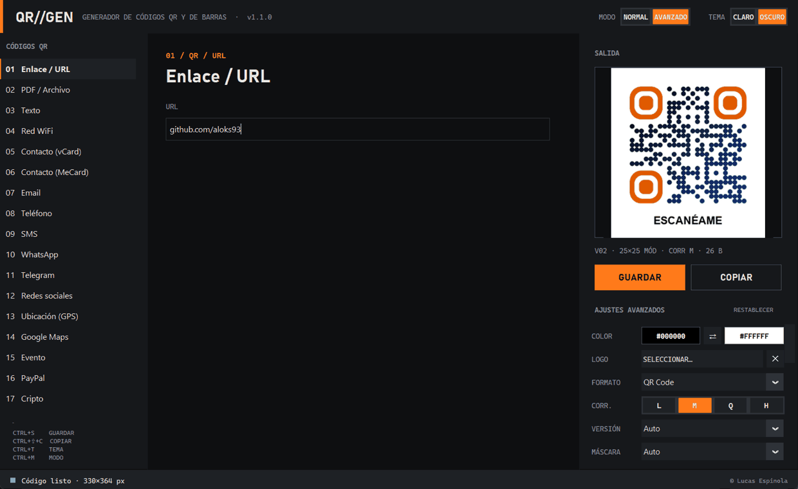
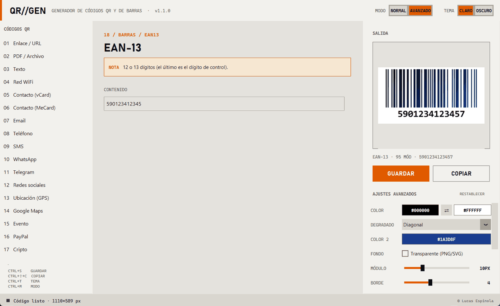
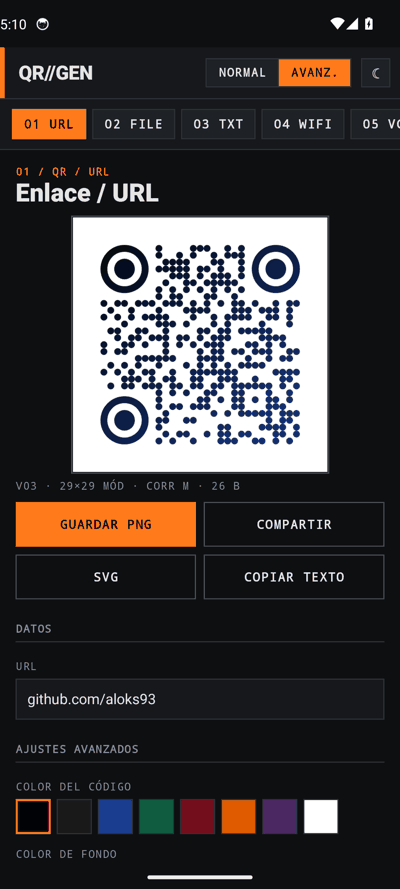

# QR//GEN — Generador de QRs y códigos de barras

Generador de códigos QR, 2D y de barras para **Windows** (app de escritorio en Python) y **Android** (app nativa en Kotlin). Vista previa en vivo, modo claro y oscuro, y dos modos de uso:

- **Normal:** solo lo básico — tipo, datos, colores y logo.
- **Avanzado:** personalización completa — formato (QR, Micro QR, Data Matrix, Aztec, PDF417), corrección de errores, versión y máscara del QR, forma de los módulos (cuadrado, redondeado, puntos, rombo) y su escala, forma y color de los «ojos», degradados (horizontal, vertical, diagonal, radial), fondo transparente, borde, tamaño, tamaño y fondo del logo, texto inferior (tamaño y color) y, en códigos de barras, altura y texto legible.

Exporta a PNG, JPG, BMP o SVG (el SVG conserva todos los estilos y el logo).



## ⬇ Descargas

| Plataforma | Archivo | Enlace |
|---|---|---|
| **Windows** — ejecutable portable | `GeneradorQR.exe` | [Descargar .exe](https://github.com/aloks93/generador-de-qrs/releases/latest/download/GeneradorQR.exe) |
| **Windows** — comprimido (exe + licencia) | `GeneradorQR-windows.zip` | [Descargar .zip](https://github.com/aloks93/generador-de-qrs/releases/latest/download/GeneradorQR-windows.zip) |
| **Android** 7.0 o superior | `GeneradorQR-android.apk` | [Descargar .apk](https://github.com/aloks93/generador-de-qrs/releases/latest/download/GeneradorQR-android.apk) |
| **Código fuente** | `GeneradorQR-source.zip` | [Descargar .zip](https://github.com/aloks93/generador-de-qrs/releases/latest/download/GeneradorQR-source.zip) |

Todas las versiones están en [Releases](https://github.com/aloks93/generador-de-qrs/releases).

- **Windows:** el `.exe` no necesita instalación ni Python. Como no está firmado digitalmente, SmartScreen puede avisar la primera vez: pulsa *Más información → Ejecutar de todas formas*.
- **Android:** abre el `.apk` en el móvil y permite «instalar apps de origen desconocido» cuando lo pida.

## Tipos de código

### Códigos QR (17 tipos de contenido)

| Código | Tipo | Qué hace al escanearlo |
|---|---|---|
| `URL` | Enlace / URL | Abre la página web |
| `FILE` | PDF / Archivo | Abre un PDF, imagen, video o cualquier archivo alojado en internet |
| `TXT` | Texto | Muestra el texto |
| `WIFI` | Red WiFi | Conecta a la red (WPA, WEP o abierta, incluso redes ocultas) |
| `VCF` | Contacto (vCard) | Guarda el contacto en la agenda |
| `MECARD` | Contacto (MeCard) | Igual, en un formato más corto (QR más pequeño) |
| `MAIL` | Email | Abre un correo con destinatario, asunto y mensaje |
| `TEL` | Teléfono | Inicia una llamada |
| `SMS` | SMS | Prepara un SMS |
| `WA` | WhatsApp | Abre un chat de WhatsApp con mensaje opcional |
| `TG` | Telegram | Abre un usuario o canal de Telegram |
| `SOC` | Redes sociales | Perfil de Instagram, Facebook, TikTok, X, YouTube, LinkedIn, GitHub o Twitch |
| `GEO` | Ubicación (GPS) | Abre las coordenadas en el mapa |
| `MAPS` | Google Maps | Busca una dirección o lugar en Google Maps |
| `CAL` | Evento | Añade un evento al calendario |
| `PAY` | PayPal | Abre PayPal.me con cantidad y moneda opcionales |
| `BTC` | Cripto | Solicitud de pago (Bitcoin, Ethereum, Litecoin…) |

En modo avanzado, cualquiera de estos contenidos puede generarse también como **Micro QR, Data Matrix, Aztec o PDF417** (Micro QR solo en escritorio).

### Códigos de barras

EAN-13, EAN-8, UPC-A, UPC-E, Code 128, Code 39, Code 93, ITF (2 de 5) y Codabar. El dígito de control se calcula solo.

Todas las simbologías tienen pruebas automáticas que generan el código y lo vuelven a **leer con un decodificador real** (zxing-cpp en Python, ZXing en Android), también con estilos aplicados.

### Sobre los PDFs y archivos

Un código QR solo puede guardar unos 3 KB, así que **un archivo no cabe dentro del QR**. Para compartir un PDF:

1. Súbelo a Google Drive, Dropbox, OneDrive o similar.
2. Compártelo como «cualquiera con el enlace puede ver».
3. Pega ese enlace en la sección **PDF / Archivo**.

## App de escritorio



1. Elige el tipo de código en la columna izquierda (QR o de barras).
2. Rellena los campos; la vista previa se actualiza sola. Los datos de cada tipo se conservan al cambiar de uno a otro.
3. Ajusta color del código y del fondo (`⇄` los intercambia) y el logo. Cambia a **AVANZADO** para el resto de opciones; **RESTABLECER** vuelve a los valores por defecto.
4. **GUARDAR** (PNG, SVG, JPG o BMP) o **COPIAR** para pegarlo en otra aplicación.

| Atajo | Acción |
|---|---|
| `Ctrl+S` | Guardar |
| `Ctrl+Shift+C` | Copiar imagen |
| `Ctrl+T` | Cambiar entre modo claro y oscuro |
| `Ctrl+M` | Cambiar entre modo normal y avanzado |

> Con logo se fuerza la corrección H (30 %) para que el QR siga leyéndose.

### Ejecutar desde el código

Requiere Python 3.10 o superior.

```bash
git clone https://github.com/aloks93/generador-de-qrs.git
cd generador-de-qrs
python -m venv .venv
.venv\Scripts\activate        # Windows
# source .venv/bin/activate   # macOS / Linux
pip install -r requirements.txt
python main.py
```

### Uso como librería

```python
from qrgen import payloads
from qrgen.generator import QROptions, save

datos = payloads.wifi("MiCasa", "clave-secreta")
save(datos, "wifi.png", QROptions(fill_color="#1a3d8f", module_shape="dots", eye_shape="rounded"))
save("590123412345", "ean.svg", QROptions(symbology="EAN13", bar_height=30))
```

### Crear el .exe

```bash
pip install pyinstaller
python scripts/build_windows.py   # → dist/GeneradorQR.exe y dist/GeneradorQR-windows.zip
```

## App Android



Código en [`android/`](android/): Kotlin + Jetpack Compose, generación con ZXing, sin permisos especiales. Incluye los mismos tipos de QR y de códigos de barras, modo normal/avanzado con las mismas opciones de estilo, modo claro/oscuro, guardado en PNG/SVG y compartir.

```bash
cd android
./gradlew assembleRelease         # → app/build/outputs/apk/release/app-release.apk
```

También se puede abrir la carpeta `android/` con Android Studio.

## Publicar una versión

Las descargas se generan automáticamente con GitHub Actions (`.github/workflows/release.yml`). Al subir una etiqueta se compilan el `.exe`, el `.zip` y el `.apk` y se adjuntan a una nueva release:

```bash
git tag v1.0.1
git push origin v1.0.1
```

## Pruebas

```bash
pip install -r requirements-dev.txt
pytest                             # Python
cd android && ./gradlew test       # Kotlin (mismos casos que en Python)
```

## Estructura

```
main.py                 # punto de entrada (escritorio)
qrgen/payloads.py       # contenido de cada tipo de QR
qrgen/symbology.py      # codificación QR / 2D / barras a matriz de módulos
qrgen/generator.py      # renderizado con estilos a imagen y SVG
qrgen/theme.py          # tema visual industrial claro/oscuro
qrgen/gui.py            # interfaz gráfica (CustomTkinter)
qrgen/clipboard.py      # copiar imagen al portapapeles (Windows)
scripts/build_windows.py
android/                # app Android (Kotlin + Compose)
tests/                  # pruebas con pytest
```

## Licencia

[MIT](LICENSE) © 2026 Lucas Espinola
